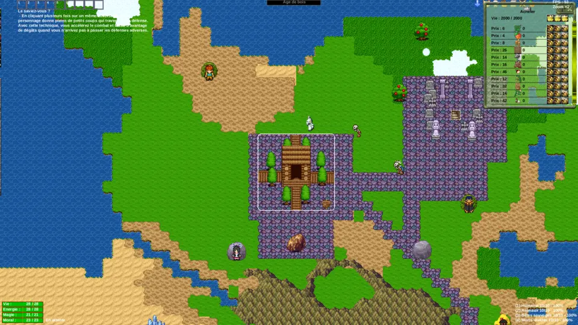

Vendetta is a 2D top-down RPG game from the early 2000s that focused on building, crafting, trading and fighting, before Minecraft ever existed.

This is a recent port with some niceties added in, including networked multiplayer.

Play in the browser: https://vendetta.qsantos.fr/

For a more recent game by the original author, look at [Aurora Dusk: Steam Age](https://store.steampowered.com/app/397160/Aurora_Dusk_Steam_Age/).

# Added features (optional)

- much faster
- runs in browser
- compatible with touch interface (can play on phone in the browser)
- networked multiplayer
- languages: Spanish, Japanese & Mandarin
- larger maps (currently up to 1024×1024, but could definitely run much larger)
- toroidal map
- more interesting maps (lakes, rivers, islands, montain ranges, etc.)
- more interesting towns (more compact layout, streets, walking around buildings)
- smart pathfinding (A*-based)
- chasing ahead (where target is heading instead of its current position)
- monsters wander large maps instead of doing nothing
- can build new home over the old one without removing it first
- intuitive pan & zoom

# Missing features

From original:

- Race treasures
- End-of-game report
- Character's progress in menu

Would be new:

- gamepad control
